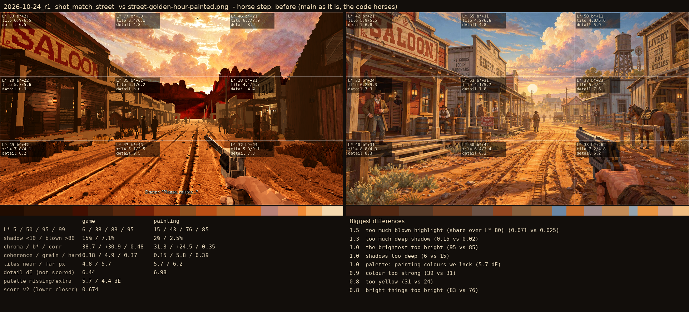

# 2026-10-24_r1: horse step: before (main as it is, the code horses)

## shot_match_street (score 0.674, lower is closer)

- 1.5 too much blown highlight (share over L* 80) (0.071 vs 0.025)
- 1.3 too much deep shadow (0.15 vs 0.02)
- 1.0 the brightest too bright (95 vs 85)
- 1.0 shadows too deep (6 vs 15)
- 1.0 palette: painting colours we lack (5.7 dE)
- 0.9 colour too strong (39 vs 31)
- 0.8 too yellow (31 vs 24)
- 0.8 bright things too bright (83 vs 76)
