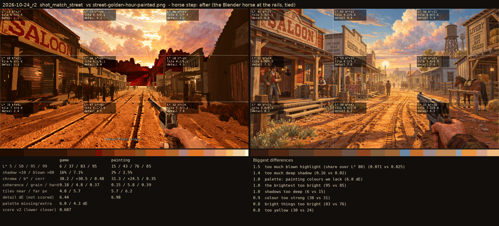

# 2026-10-24_r2: horse step: after (the Blender horse at the rails, tied)

## shot_match_street (score 0.687, lower is closer)

- 1.5 too much blown highlight (share over L* 80) (0.071 vs 0.025)
- 1.4 too much deep shadow (0.16 vs 0.02)
- 1.0 palette: painting colours we lack (6.0 dE)
- 1.0 the brightest too bright (95 vs 85)
- 1.0 shadows too deep (6 vs 15)
- 0.9 colour too strong (38 vs 31)
- 0.8 bright things too bright (83 vs 76)
- 0.8 too yellow (30 vs 24)
