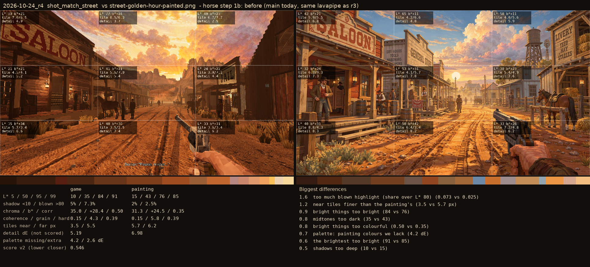

# 2026-10-24_r4: horse step 1b: before (main today, same lavapipe as r3)

## shot_match_street (score 0.546, lower is closer)

- 1.6 too much blown highlight (share over L* 80) (0.073 vs 0.025)
- 1.2 near tiles finer than the painting's (3.5 vs 5.7 px)
- 0.9 bright things too bright (84 vs 76)
- 0.8 midtones too dark (35 vs 43)
- 0.8 bright things too colourful (0.50 vs 0.35)
- 0.7 palette: painting colours we lack (4.2 dE)
- 0.6 the brightest too bright (91 vs 85)
- 0.5 shadows too deep (10 vs 15)
