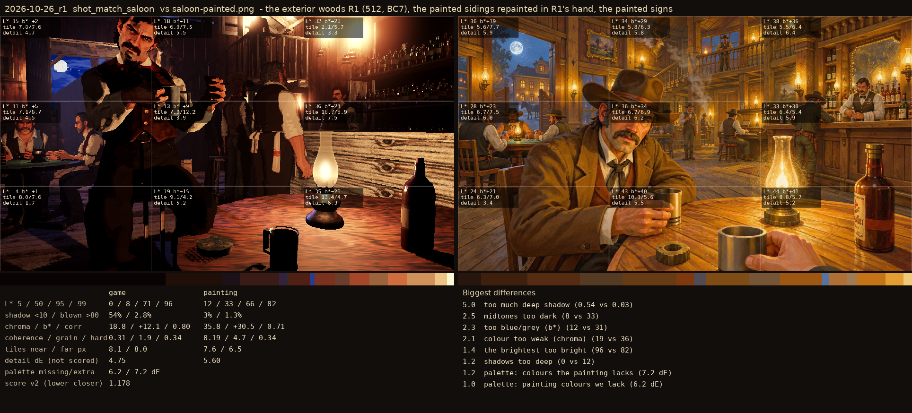
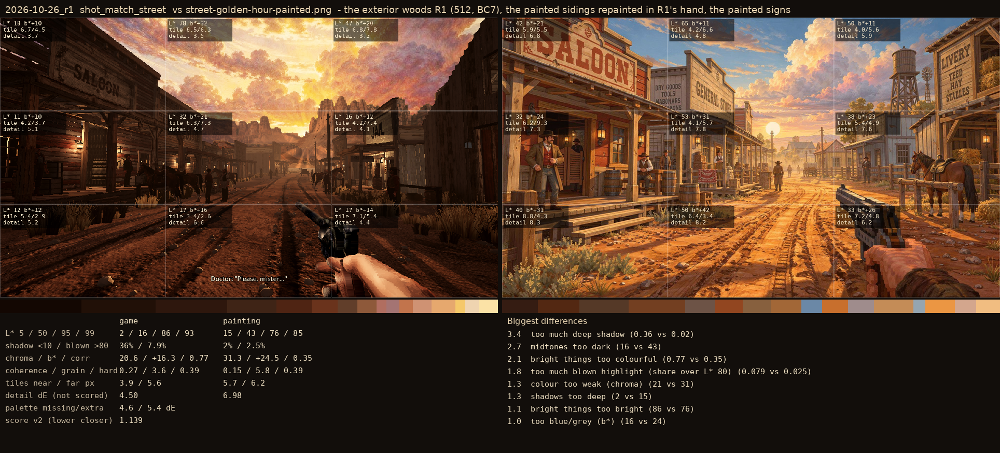

# 2026-10-26_r1: the exterior woods R1 (512, BC7), the painted sidings repainted in R1's hand, the painted signs

## shot_match_saloon (score 1.178, lower is closer)

- 5.0 too much deep shadow (0.54 vs 0.03)
- 2.5 midtones too dark (8 vs 33)
- 2.3 too blue/grey (b*) (12 vs 31)
- 2.1 colour too weak (chroma) (19 vs 36)
- 1.4 the brightest too bright (96 vs 82)
- 1.2 shadows too deep (0 vs 12)
- 1.2 palette: colours the painting lacks (7.2 dE)
- 1.0 palette: painting colours we lack (6.2 dE)

## shot_match_street (score 1.139, lower is closer)

- 3.4 too much deep shadow (0.36 vs 0.02)
- 2.7 midtones too dark (16 vs 43)
- 2.1 bright things too colourful (0.77 vs 0.35)
- 1.8 too much blown highlight (share over L* 80) (0.079 vs 0.025)
- 1.3 colour too weak (chroma) (21 vs 31)
- 1.3 shadows too deep (2 vs 15)
- 1.1 bright things too bright (86 vs 76)
- 1.0 too blue/grey (b*) (16 vs 24)
