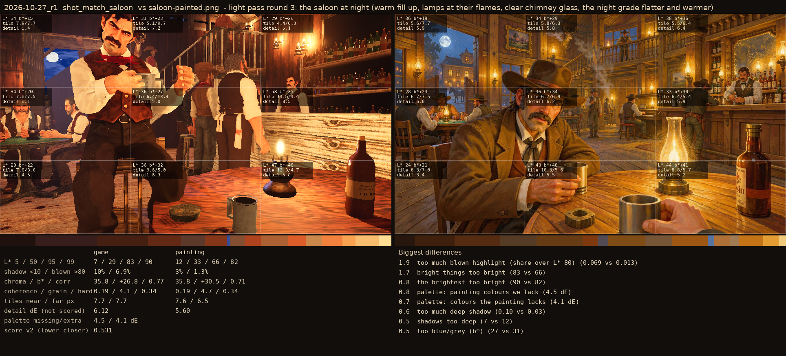
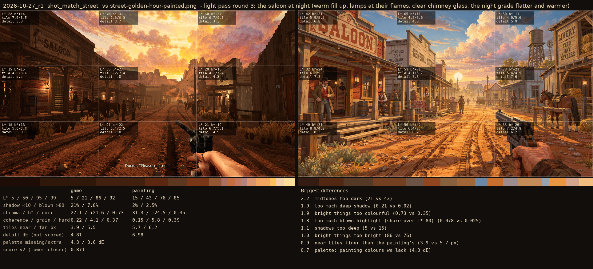

# 2026-10-27_r1: light pass round 3: the saloon at night (warm fill up, lamps at their flames, clear chimney glass, the night grade flatter and warmer)

## shot_match_saloon (score 0.531, lower is closer)

- 1.9 too much blown highlight (share over L* 80) (0.069 vs 0.013)
- 1.7 bright things too bright (83 vs 66)
- 0.8 the brightest too bright (90 vs 82)
- 0.8 palette: painting colours we lack (4.5 dE)
- 0.7 palette: colours the painting lacks (4.1 dE)
- 0.6 too much deep shadow (0.10 vs 0.03)
- 0.5 shadows too deep (7 vs 12)
- 0.5 too blue/grey (b*) (27 vs 31)

## shot_match_street (score 0.871, lower is closer)

- 2.2 midtones too dark (21 vs 43)
- 1.9 too much deep shadow (0.21 vs 0.02)
- 1.9 bright things too colourful (0.73 vs 0.35)
- 1.8 too much blown highlight (share over L* 80) (0.078 vs 0.025)
- 1.1 shadows too deep (5 vs 15)
- 1.0 bright things too bright (86 vs 76)
- 0.9 near tiles finer than the painting's (3.9 vs 5.7 px)
- 0.7 palette: painting colours we lack (4.3 dE)
