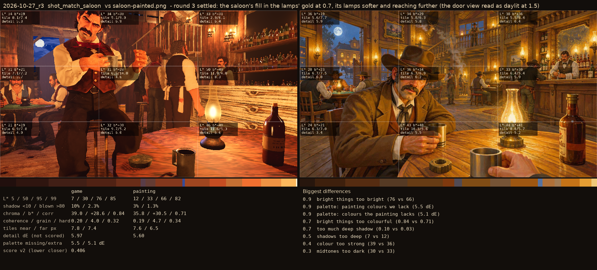
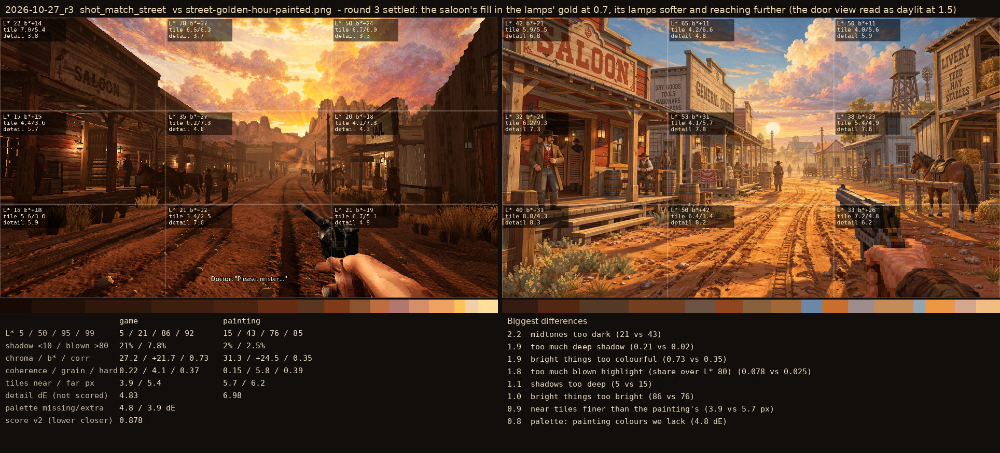

# 2026-10-27_r3: round 3 settled: the saloon's fill in the lamps' gold at 0.7, its lamps softer and reaching further (the door view read as daylit at 1.5)

## shot_match_saloon (score 0.406, lower is closer)

- 0.9 bright things too bright (76 vs 66)
- 0.9 palette: painting colours we lack (5.5 dE)
- 0.9 palette: colours the painting lacks (5.1 dE)
- 0.7 bright things too colourful (0.84 vs 0.71)
- 0.7 too much deep shadow (0.10 vs 0.03)
- 0.5 shadows too deep (7 vs 12)
- 0.4 colour too strong (39 vs 36)
- 0.3 midtones too dark (30 vs 33)

## shot_match_street (score 0.878, lower is closer)

- 2.2 midtones too dark (21 vs 43)
- 1.9 too much deep shadow (0.21 vs 0.02)
- 1.9 bright things too colourful (0.73 vs 0.35)
- 1.8 too much blown highlight (share over L* 80) (0.078 vs 0.025)
- 1.1 shadows too deep (5 vs 15)
- 1.0 bright things too bright (86 vs 76)
- 0.9 near tiles finer than the painting's (3.9 vs 5.7 px)
- 0.8 palette: painting colours we lack (4.8 dE)
