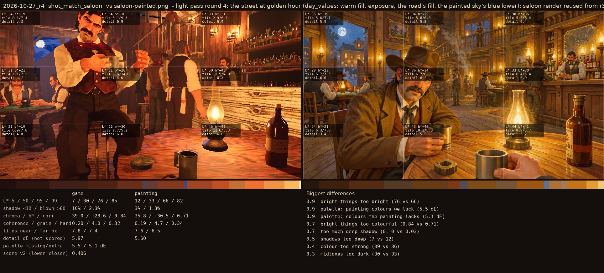
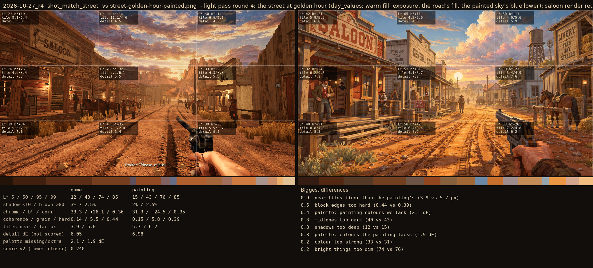

# 2026-10-27_r4: light pass round 4: the street at golden hour (day_values: warm fill, exposure, the road's fill, the painted sky's blue lower); saloon render reused from r3 (23:40, untouched)

## shot_match_saloon (score 0.406, lower is closer)

- 0.9 bright things too bright (76 vs 66)
- 0.9 palette: painting colours we lack (5.5 dE)
- 0.9 palette: colours the painting lacks (5.1 dE)
- 0.7 bright things too colourful (0.84 vs 0.71)
- 0.7 too much deep shadow (0.10 vs 0.03)
- 0.5 shadows too deep (7 vs 12)
- 0.4 colour too strong (39 vs 36)
- 0.3 midtones too dark (30 vs 33)

## shot_match_street (score 0.240, lower is closer)

- 0.9 near tiles finer than the painting's (3.9 vs 5.7 px)
- 0.5 block edges too hard (0.44 vs 0.39)
- 0.4 palette: painting colours we lack (2.1 dE)
- 0.3 midtones too dark (40 vs 43)
- 0.3 shadows too deep (12 vs 15)
- 0.3 palette: colours the painting lacks (1.9 dE)
- 0.2 colour too strong (33 vs 31)
- 0.2 bright things too dim (74 vs 76)
