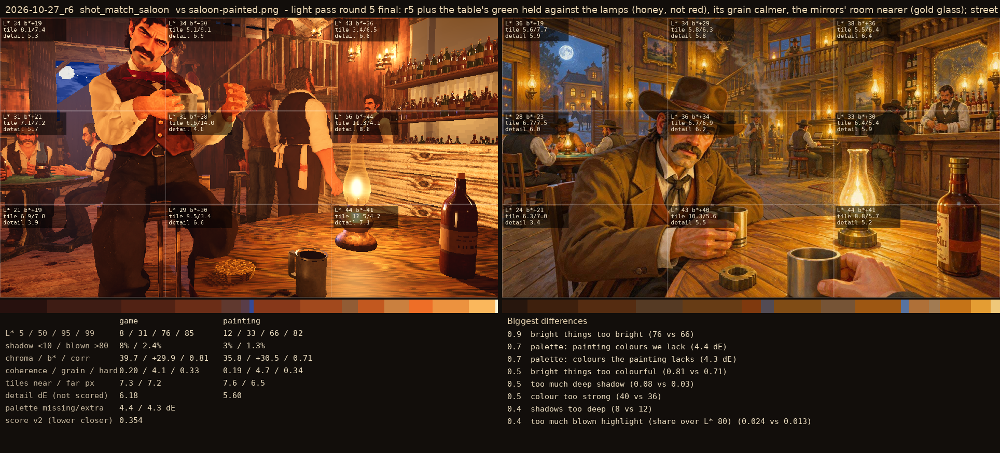
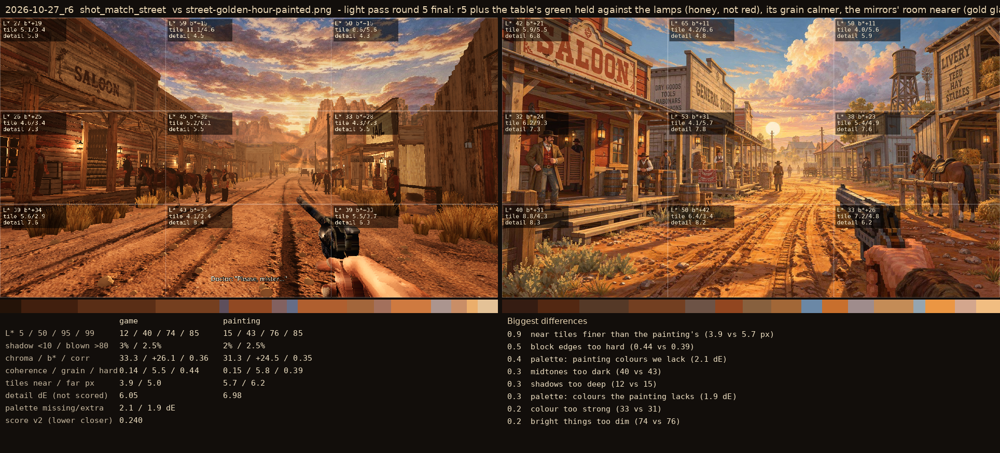

# 2026-10-27_r6: light pass round 5 final: r5 plus the table's green held against the lamps (honey, not red), its grain calmer, the mirrors' room nearer (gold glass); street render reused from r4

## shot_match_saloon (score 0.354, lower is closer)

- 0.9 bright things too bright (76 vs 66)
- 0.7 palette: painting colours we lack (4.4 dE)
- 0.7 palette: colours the painting lacks (4.3 dE)
- 0.5 bright things too colourful (0.81 vs 0.71)
- 0.5 too much deep shadow (0.08 vs 0.03)
- 0.5 colour too strong (40 vs 36)
- 0.4 shadows too deep (8 vs 12)
- 0.4 too much blown highlight (share over L* 80) (0.024 vs 0.013)

## shot_match_street (score 0.240, lower is closer)

- 0.9 near tiles finer than the painting's (3.9 vs 5.7 px)
- 0.5 block edges too hard (0.44 vs 0.39)
- 0.4 palette: painting colours we lack (2.1 dE)
- 0.3 midtones too dark (40 vs 43)
- 0.3 shadows too deep (12 vs 15)
- 0.3 palette: colours the painting lacks (1.9 dE)
- 0.2 colour too strong (33 vs 31)
- 0.2 bright things too dim (74 vs 76)
