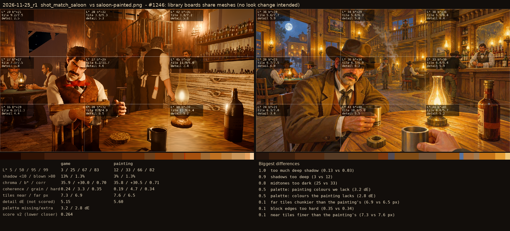
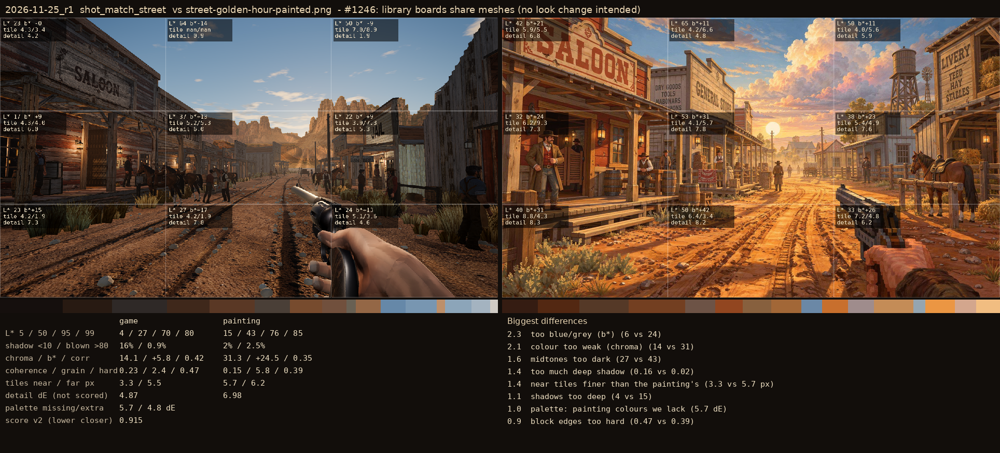

# 2026-11-25_r1: #1246: library boards share meshes (no look change intended)

## shot_match_saloon (score 0.264, lower is closer)

- 1.0 too much deep shadow (0.13 vs 0.03)
- 0.9 shadows too deep (3 vs 12)
- 0.8 midtones too dark (25 vs 33)
- 0.5 palette: painting colours we lack (3.2 dE)
- 0.5 palette: colours the painting lacks (2.8 dE)
- 0.1 far tiles chunkier than the painting's (6.9 vs 6.5 px)
- 0.1 block edges too hard (0.35 vs 0.34)
- 0.1 near tiles finer than the painting's (7.3 vs 7.6 px)

## shot_match_street (score 0.915, lower is closer)

- 2.3 too blue/grey (b*) (6 vs 24)
- 2.1 colour too weak (chroma) (14 vs 31)
- 1.6 midtones too dark (27 vs 43)
- 1.4 too much deep shadow (0.16 vs 0.02)
- 1.4 near tiles finer than the painting's (3.3 vs 5.7 px)
- 1.1 shadows too deep (4 vs 15)
- 1.0 palette: painting colours we lack (5.7 dE)
- 0.9 block edges too hard (0.47 vs 0.39)
