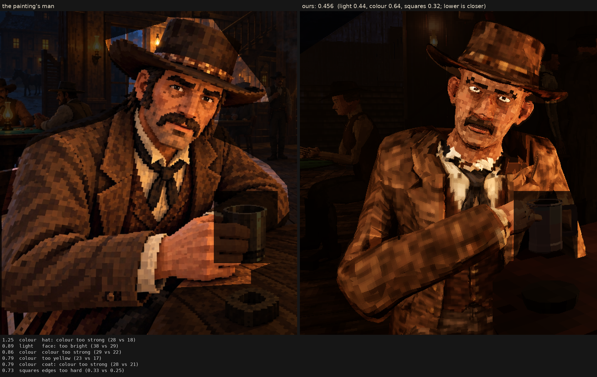

# Character judge, 2026-10-10_r1

faces test: the house head (MakeHuman base, drawn face, stamps) on stranger2s's body and hat

Score **0.456** (the mean severity; lower is closer): light 0.440, colour 0.636, squares 0.317. From `docs/screenshots/tripo/judge/renders/faces_test`, against the man in `saloon-blocks.png`.

| Severity | Group | Difference |
|---|---|---|
| 1.25 | colour | hat: colour too strong (28 vs 18) |
| 0.89 | light | face: too bright (38 vs 29) |
| 0.86 | colour | colour too strong (29 vs 22) |
| 0.79 | colour | too yellow (23 vs 17) |
| 0.79 | colour | coat: colour too strong (28 vs 21) |
| 0.73 | squares | edges too hard (0.33 vs 0.25) |
| 0.64 | colour | face: colour too strong (39 vs 34) |
| 0.63 | light | bright parts too bright (59 vs 53) |
| 0.62 | light | too little deep shadow (share under L* 10) (0.24 vs 0.31) |
| 0.61 | squares | face: squares smaller (5.7 vs 7.4 px) |
| 0.52 | light | coat: lit parts too bright (46 vs 40) |
| 0.51 | light | hat: too bright (18 vs 13) |
| 0.51 | squares | squares flatter than the painting's (one tone, edge to edge) (0.64 vs 0.59) |
| 0.47 | squares | grain in his flat parts (5.1 vs 4.4 dE) |
| 0.41 | light | too much blown highlight (share over L* 80) (0.013 vs 0.001) |
| 0.38 | light | hat: lit parts too bright (38 vs 34) |
| 0.32 | light | face: lit parts too bright (58 vs 55) |
| 0.31 | colour | bright parts too pale (chroma-L* correlation) (0.83 vs 0.89) |
| 0.26 | colour | palette: colours the painting lacks (1.5 dE) |
| 0.25 | light | midtones too bright (20 vs 17) |
| 0.24 | squares | squares smaller than the painting's (7.5 vs 8.2 px) |
| 0.22 | light | coat: too bright (19 vs 17) |
| 0.19 | colour | palette: the painting's colours we lack (1.1 dE) |
| 0.18 | squares | squares too different from their neighbours (7.0 vs 6.5) |
| 0.11 | squares | hat: squares smaller (7.7 vs 8.0 px) |
| 0.09 | light | shadows too light (2 vs 1) |
| 0.00 | squares | noisier than paint (coherence 0.22 vs 0.21) |
| 0.00 | squares | coat: squares bigger (8.3 vs 8.3 px) |

