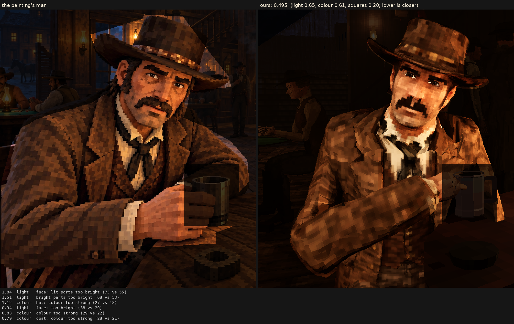

# Character judge, 2026-10-11_r1

E5: the moustache drawn (dark, toned, nostrils, a gap one square wide, owned by square) and the collar from his model with a contact shadow, as his defaults (branch claude/characters-protected-features)

Score **0.495** (the mean severity; lower is closer): light 0.646, colour 0.614, squares 0.203. From `/tmp/claude-0/-home-user-Western/429a14da-a960-53b6-ba70-7e4725a94f63/scratchpad/e5/shot`, against the man in `saloon-blocks.png`.

| Severity | Group | Difference |
|---|---|---|
| 1.84 | light | face: lit parts too bright (73 vs 55) |
| 1.51 | light | bright parts too bright (68 vs 53) |
| 1.12 | colour | hat: colour too strong (27 vs 18) |
| 0.94 | light | face: too bright (38 vs 29) |
| 0.83 | colour | colour too strong (29 vs 22) |
| 0.79 | colour | coat: colour too strong (28 vs 21) |
| 0.78 | colour | too yellow (23 vs 17) |
| 0.66 | light | too much blown highlight (share over L* 80) (0.020 vs 0.001) |
| 0.58 | light | too little deep shadow (share under L* 10) (0.25 vs 0.31) |
| 0.50 | colour | face: colour too strong (38 vs 34) |
| 0.49 | squares | edges too hard (0.30 vs 0.25) |
| 0.45 | light | hat: too bright (17 vs 13) |
| 0.40 | light | coat: lit parts too bright (44 vs 40) |
| 0.40 | squares | grain in his flat parts (5.0 vs 4.4 dE) |
| 0.39 | colour | bright parts too pale (chroma-L* correlation) (0.81 vs 0.89) |
| 0.35 | squares | squares too different from their neighbours (7.5 vs 6.5) |
| 0.28 | colour | palette: colours the painting lacks (1.7 dE) |
| 0.24 | light | midtones too bright (19 vs 17) |
| 0.23 | light | coat: too bright (19 vs 17) |
| 0.22 | colour | palette: the painting's colours we lack (1.3 dE) |
| 0.21 | squares | squares flatter than the painting's (one tone, edge to edge) (0.61 vs 0.59) |
| 0.20 | squares | coat: squares bigger (9.0 vs 8.3 px) |
| 0.19 | light | hat: lit parts too bright (36 vs 34) |
| 0.09 | squares | hat: squares smaller (7.7 vs 8.0 px) |
| 0.08 | squares | squares bigger than the painting's (8.5 vs 8.2 px) |
| 0.07 | light | shadows too light (2 vs 1) |
| 0.01 | squares | face: squares bigger (7.4 vs 7.4 px) |
| 0.00 | squares | noisier than paint (coherence 0.22 vs 0.21) |

