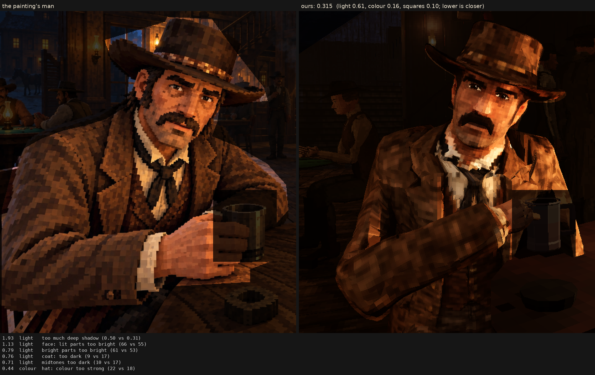

# Character judge, 2026-10-11_r2

his lightest skin eased (bake.face top 38/0.5), eye gain 1.4, the faces test's moustache shell, lip line and nose tip; the same light

Score **0.315** (the mean severity; lower is closer): light 0.607, colour 0.161, squares 0.096. From `docs/screenshots/tripo/judge/renders/carry_overs`, against the man in `saloon-blocks.png`.

| Severity | Group | Difference |
|---|---|---|
| 1.93 | light | too much deep shadow (0.50 vs 0.31) |
| 1.13 | light | face: lit parts too bright (66 vs 55) |
| 0.79 | light | bright parts too bright (61 vs 53) |
| 0.76 | light | coat: too dark (9 vs 17) |
| 0.71 | light | midtones too dark (10 vs 17) |
| 0.44 | colour | hat: colour too strong (22 vs 18) |
| 0.39 | light | face: too dark (25 vs 29) |
| 0.34 | squares | edges too hard (0.29 vs 0.25) |
| 0.30 | light | hat: too dark (10 vs 13) |
| 0.29 | light | too much blown highlight (share over L* 80) (0.009 vs 0.001) |
| 0.24 | light | hat: lit parts too bright (36 vs 34) |
| 0.24 | colour | coat: colour too weak (19 vs 21) |
| 0.22 | colour | palette: the painting's colours we lack (1.3 dE) |
| 0.21 | colour | palette: colours the painting lacks (1.2 dE) |
| 0.18 | squares | squares flatter than the painting's (one tone, edge to edge) (0.61 vs 0.59) |
| 0.11 | light | coat: lit parts too bright (42 vs 40) |
| 0.10 | squares | coat: squares bigger (8.6 vs 8.3 px) |
| 0.08 | squares | hat: squares smaller (7.8 vs 8.0 px) |
| 0.07 | colour | bright parts too pale (chroma-L* correlation) (0.88 vs 0.89) |
| 0.07 | squares | squares too alike (a smooth surface) (6.2 vs 6.5) |
| 0.06 | colour | face: colour too strong (35 vs 34) |
| 0.06 | squares | squares bigger than the painting's (8.4 vs 8.2 px) |
| 0.04 | colour | colour too weak (chroma) (22 vs 22) |
| 0.03 | light | shadows too light (1 vs 1) |
| 0.03 | squares | face: squares bigger (7.5 vs 7.4 px) |
| 0.01 | colour | too yellow (17 vs 17) |
| 0.00 | squares | noisier than paint (coherence 0.30 vs 0.21) |
| 0.00 | squares | grain in his flat parts (3.6 vs 4.4 dE) |

