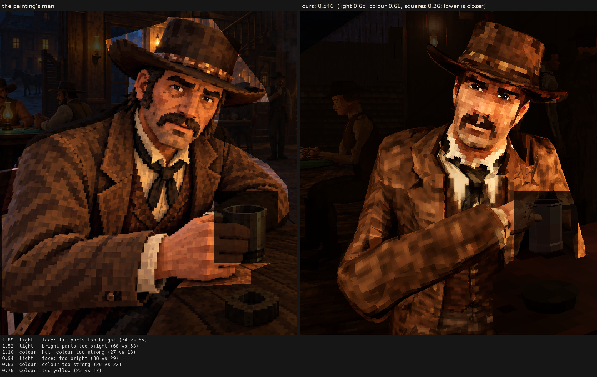

# Character judge, 2026-10-11_r3

E9: the moustache's ends drooping, its outline rounded, warmer brown (characters.json stranger2s.bake.moustache)

Score **0.546** (the mean severity; lower is closer): light 0.650, colour 0.615, squares 0.359. From `/tmp/claude-0/-home-user-Western/429a14da-a960-53b6-ba70-7e4725a94f63/scratchpad/e9/shot_e`, against the man in `saloon-blocks.png`.

| Severity | Group | Difference |
|---|---|---|
| 1.89 | light | face: lit parts too bright (74 vs 55) |
| 1.52 | light | bright parts too bright (68 vs 53) |
| 1.10 | colour | hat: colour too strong (27 vs 18) |
| 0.94 | light | face: too bright (38 vs 29) |
| 0.83 | colour | colour too strong (29 vs 22) |
| 0.78 | colour | too yellow (23 vs 17) |
| 0.78 | colour | coat: colour too strong (28 vs 21) |
| 0.69 | light | too much blown highlight (share over L* 80) (0.021 vs 0.001) |
| 0.68 | squares | squares flatter than the painting's (one tone, edge to edge) (0.66 vs 0.59) |
| 0.67 | squares | edges too hard (0.32 vs 0.25) |
| 0.57 | light | too little deep shadow (share under L* 10) (0.25 vs 0.31) |
| 0.53 | colour | face: colour too strong (38 vs 34) |
| 0.53 | squares | grain in his flat parts (5.2 vs 4.4 dE) |
| 0.43 | squares | hat: squares smaller (6.8 vs 8.0 px) |
| 0.41 | light | hat: too bright (17 vs 13) |
| 0.41 | colour | bright parts too pale (chroma-L* correlation) (0.81 vs 0.89) |
| 0.39 | light | coat: lit parts too bright (44 vs 40) |
| 0.35 | squares | squares too different from their neighbours (7.5 vs 6.5) |
| 0.29 | colour | palette: colours the painting lacks (1.7 dE) |
| 0.28 | squares | face: squares smaller (6.6 vs 7.4 px) |
| 0.23 | light | midtones too bright (19 vs 17) |
| 0.23 | light | coat: too bright (19 vs 17) |
| 0.21 | light | hat: lit parts too bright (36 vs 34) |
| 0.20 | colour | palette: the painting's colours we lack (1.2 dE) |
| 0.13 | squares | coat: squares bigger (8.7 vs 8.3 px) |
| 0.08 | squares | noisier than paint (coherence 0.21 vs 0.21) |
| 0.08 | squares | squares smaller than the painting's (7.9 vs 8.2 px) |
| 0.07 | light | shadows too light (2 vs 1) |

