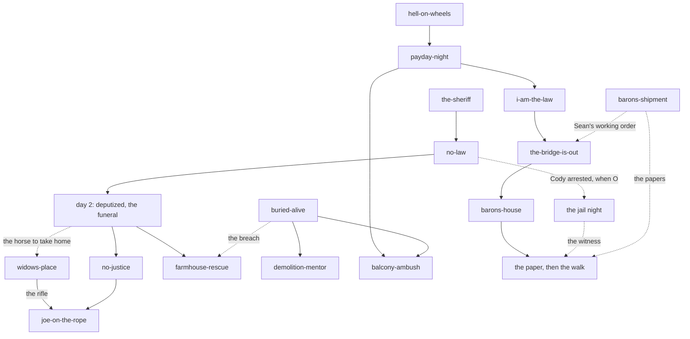

# The outline: the whole story, start to finish

The story bible, part 1 of 5 (#809). Planning only: nothing here changes the game. Built 2026-11-11
from the mission cards (`docs/missions/`, on PR #743's branch `claude/planning-missions-cards-mwdo42`
until that PR merges), `DESIGN.md` §5, and issues #738, #736, #744, #789, #809, #810. Where a card
and Sean's decisions of 2026-11-11 (#744, #809) differ, the decisions win and the card is listed at
the end as out of date.

**Every line carries its status**, the cards' way (`docs/missions/README.md`):
- **D** = DECIDED: Sean's call, with its date. Nothing here is upgraded to D.
- **P** = PROPOSED by Sean or an earlier session, never confirmed.
- **P·bible** = proposed by this bible to fill a hole. Sean hasn't seen it. Never build on one.
- **O** = OPEN. The numbered ones are in `CONTRADICTIONS.md` (C1–C15) for Sean to pick.

The other parts: `SETUPS.md` (what's planted where), `VOICES.md` (who talks how, and who knows what
when), `WORDS.md` (1880s speech), `CONTRADICTIONS.md` (what doesn't fit). One-page summary: `README.md`.

## The story in one paragraph

Salt Creek, 1882. Water is the stakes. The cattle Baron wants every drop in the valley, and the law
won't let him use the Army to take a quiet town (the Posse Comitatus Act, 1878), so he sets out to
make Salt Creek **look like a town in revolt**: staged attacks, telegrams, fights in front of an
Army captain (D, 2026-11-11). His hired guns shoot the sheriff over the family's water right, raid a
Southern Ute camp, wreck a train and saw through a dance floor. Thomas Harlan, a homesteader and
former army hospital steward, finds the sheriff dying on the road, is sworn in as his deputy, and
becomes the one thing standing between the Baron and his lie. With Joe, a Southern Ute widower, he
learns that the law fails (No Justice), holds it up anyway, takes the Baron's papers, blows the
trestle under the train that comes for the town, and arrests the Baron in his own house. What the
newspaper and the town say afterwards depends on the evidence he kept and the people he kept alive.

## How the order works

No day count: "the story doesn't advance until it should advance" (D, 2026-11-01). A mission opens
when its conditions are met; people nudge, nothing forces. The town's calendar (the daily train, the
stage, payday) runs whatever Harlan does. So each act below has a **fixed part** (it has to happen in
that order) and an **open part** (any order, or never).

Solid arrows are D; dotted are P or O, or what one mission hands another. How Harlan hears of Buried
Alive, the Shipment and the last train is mostly O (see `SETUPS.md`, "Missing").

---

## Act I: becoming the law

**Fixed, in this order** (D, 2026-11-09, the opening):

| # | Mission | What happens | What it reveals | Threads |
|---|---|---|---|---|
| 1 | [`the-sheriff`](../missions/the-sheriff.md), day 1, dawn | Harlan walks down from his homestead and finds the sheriff gut-shot on the East Road. Nod to help, shake to leave. Pack the wound, lead him in on his own horse, the doctor's. | The sheriff was shot by "a man in a faded red shirt" who "rode up easy" (built lines). Harlan's hands know wounds. | T1 opens |
| 2 | [`no-law`](../missions/no-law.md), night 1 | The saloon. Harlan is seated and unarmed; a stranger's hand is on his arm. **Cody**, one of the Baron's hired guns, kicks Earl's chair out and shoots him over cards: "Ain't no law left in this valley to save you now." He rides for the foothills. | Nobody will stop a murder. The stranger knew it was coming. A player who follows sees which way Cody rode. | T1, T7 |
| – | The same night, unseen | Cody's crew, led by **Silas Kett** (the red shirt), raids Joe's camp while the men are hunting. Joe's wife is raped, murdered and scalped (D, 2026-11-09, 2026-11-11). | Nothing yet: Harlan hears of it in No Justice. | T2 |
| 3 | Day 2 | The sheriff dies at the doctor's, his wife there. His last words follow day 1's care. He swears Harlan in and gives him his revolver; a shake gets "That's not the way this works, son." The funeral: attend or not. **The Baron offers the widow a price for her claim** at the graveside. | The Baron's face and what he wants. Harlan is a deputy, "temporarily" (what that ends with: O, C12). | T1, T4 opens |
| 4 | [`no-justice`](../missions/no-justice.md) | Harlan meets Joe (the doctor's office on Sean's card; flagged O by Sean). The camp; the survivors name a faded red shirt. Joe dresses as a cowboy. The hideout: five or six men. Kett runs for the cabin and surrenders. Joe draws his knife: "Are you going to stop me?" Nod or shake. | The man who shot the sheriff killed Joe's wife. The law will not punish him. | T2 opens, T1, T7 |

**No Justice's endings** (all D, 2026-11-09):
- **Arrest (nod):** Kett goes to the jail, then off on the train to "the proper authorities" (who: O, C8),
  is released, and comes back the same way. The man on the platform who lets him go is Rourke or his
  officer. Kett walks Main Street. The camp's trust cools.
- **Revenge (shake):** Joe kills and scalps him in the cabin. The bodies are found; the town splits;
  the camp trusts Harlan; the gang's kin or friends come looking.
- **Harlan shoots the surrendered man:** murder, and Joe saw it. **Killed outside in the fight:** no
  question is asked; Joe is furious.

**Open, once he has the badge** (any order; each row says what it waits for):

| Mission | Opens when | What it reveals or gives | Threads |
|---|---|---|---|
| [`widows-place`](../missions/widows-place.md) | The livery man: the sheriff's horse "eats his oats"; someone should take it home (D). Its place after No Justice is P (`BUILD_ORDER.md`). | The stakes at her ditch (the water is the motive). The boys and Blue. The ways into her house. She gives him the sheriff's **Winchester** (D), maybe the horse (P, Sean's maybe). | T4, T1 |
| [`joe-on-the-rope`](../missions/joe-on-the-rope.md) | After No Justice **and** after the rifle (D, 2026-11-04). Arrest ending: Joe kills Kett on Main Street and the town strings him up. Revenge ending: the kin come for him. | Joe is hauled up choking, not dropped: 3–4 chances at the rope from distance, or close in and cut him down (D, 2026-11-11). Fail and he's dead for good. | T2, T7 |
| The jail night ([`hold-him`](../missions/hold-him.md)) | Cody is in the cell for Earl's murder (D; how and when he's arrested: O, C6) | The Baron's men come to free him or to silence him, and the player doesn't know which (D, 2026-11-11). Alive and safe, Cody is the first man who can tie the Baron to the sheriff's murder and the raid. | T1, T7, T4 |
| Law work: `store-robbery`, `the-bounty`, `small-fights`, `stage-held-up` | Any time (P) | The Colters met as a separate outfit (P). A deputy's ordinary days. | T6, T7 |

**Where Act I leaves things:** Harlan has the badge, the revolver and (if he rode out) the rifle. The
sheriff's killer is dead in every branch but one that is still O (Harlan murdered him: the rope's
cause is unsettled). Who **ordered** it is the question the rest of the game answers.

---

## Act II: learning the valley

No fixed order except **Buried Alive before the Mentor**, and no dynamite breach before Buried Alive
(D, inventory 2026-11-09; the lock, 2026-11-03).

| Mission | Opens when | What it reveals or gives | Threads |
|---|---|---|---|
| [`buried-alive`](../missions/buried-alive.md) | O: no source says how Harlan hears (P·bible: the mine's whistle blowing off its hour, heard across the valley) | Miners trapped after a blast. Dig, shore or blast in. **Single sticks** from the miner (D, 2026-11-04). The human cost of the mine. | T3 opens |
| [`demolition-mentor`](../missions/demolition-mentor.md) | After Buried Alive, if the miner lived (if he died: O) | Half-sticks, linked charges; **bundles at the end** (D). Maybe optional lessons (P). | T3 |
| [`farmhouse-rescue`](../missions/farmhouse-rescue.md) | The widow refused the Baron at the funeral, so it can come any time after day 2. She isn't at the store on her day; a rover talks in town (D, v2) | Gunmen hold her house; the Baron's foreman walks up the lane with a deed for her to sign. In 1882 Colorado the first to use water owns it, so the Baron needs her name. Front, back, a planted stick, stop the foreman, walk him in, or let her sign. Then her boys. **Who the gunmen are: O, C5.** | T4, T6 |
| `vaqueros-horses`, `dry-creek`, `kid-wants-out` | P, unplaced | The Baron taking in small ways; the Kid as a man who wants out. | T4, T6 |

**What Act II has to do for the story** (the story judge's complaint, 2026-11-09: the middle had no
reason): show the Baron's hand before the conspiracy is named. The farmhouse does it (his answer to
her refusal). Joe needs one beat here too: the rope is it, if the player hasn't done it yet.

---

## Act III: the conspiracy shows

**Fixed, in this order** (D): Hell on Wheels, then Payday Night that same night, then I Am the Law
the next day.

| # | Mission | What happens | What it reveals | Threads |
|---|---|---|---|---|
| 1 | [`hell-on-wheels`](../missions/hell-on-wheels.md) | The mine's payroll is on Thursday's train. Gang A boards to rob the express car. Gang B, two men paid by the Baron's foreman, pulls a rail west of the depot to **wreck** it with everyone aboard (D, v2, 2026-11-09). Five ways to stop it, a sixth proposed. | Two gangs, one double-cross. A wreck with dead passengers was the outrage the Baron wanted. Gang B's man, taken alive, names the foreman. | T5 opens wide, T4, T6 |
| 2 | [`payday-night`](../missions/payday-night.md) | Harlan stopped the train being robbed and derailed, and the town pulls him into the dance to celebrate saving the pay (D, 2026-11-11). A travelling band that came in on that train plays (P, Sean). **The dance floor's girder has been sawn, and the floor comes down: an event that happens**, not one the player can skip. He's an observer and can be hurt in the fall, but shouldn't normally die. Then the wounded, one doctor, and **Rourke** with an Army surgeon and a letter already written for the deputy to sign. | The Baron did this to the town. Rourke expected the night. Harlan is a steward, in front of everyone. | T5 (the hinge), T4, T8 |
| 3 | [`i-am-the-law`](../missions/i-am-the-law.md) | An Army captain has one day to report whether Salt Creek is in revolt. The Baron's men stage one: shoves until guns come out, a shot at dusk, a stolen Ute saddle left on the East Road, and Joe goaded (if Joe is dead, someone else: D, 2026-11-11; who: O). Keep the peace where the captain can't see the keeping. | The plan, in plain sight. The captain's wire is the verdict: **quiet day, hired guns on the last train; violent day, soldiers under orders** (D). | T5, T4, T2, T7 |

### The payroll: three versions, in context (left to this bible by Sean, #744; his pick is C1)

What's settled around it: Rourke comes no matter what (D, 2026-11-09). Payday Night follows the pay
being **saved**, and the floor falls whatever Harlan did on the train (D, 2026-11-11). The question
Sean left: if the payroll is saved, does the Baron's outrage still happen, and how?

- **A. Two barrels.** The Baron planned the wreck and the floor for the same day, so that one would
  land. The saw was bought that morning, before anyone knew how the train would go. Saving the pay
  costs him nothing, and Harlan's win is what fills the dance floor. *It gives:* a Baron who is
  always a move ahead, and the cruellest irony (the people he saved at noon fall at night). *It
  costs:* the player's win on the train changes nothing in the story.
- **B. "The deputy stole it."** The pay is saved, but the count comes up short, and by morning the
  Baron's men are saying the deputy helped himself (Sean's twist, 2026-11-11). The floor still
  falls. *It gives:* the next day's captain a second charge to weigh, and the town's testimony a
  reason to split. *It costs:* a new thing to build (a count, an accusation people repeat), and it
  turns the game's one clean win sour.
- **C. It really worked.** Saving the pay beats him: no wreck, no dead passengers, a town cheering
  its deputy. The floor is the Baron **trying something else, in a hurry**, the same afternoon. That
  is why it leaves traces (a saw sold to a stranger, sawdust on a coat) and why a curious player has
  one or two ways to find out. Rourke was coming to dine with the Baron either way. *It gives:* the
  player a real win and a reason the Baron slips. *It costs:* Rourke's letter can't be "dated that
  afternoon, the ink long dry" unless he was told at noon.

All three can end with the same Payday Night. They differ in what Cody, the foreman and Rourke may
**say** afterwards, which is why the scripts need the pick. And none of them says what Payday Night
is if the train **was** wrecked or the pay lost: that's C2.

**Open in Act III** (P, unplaced): `kid-wants-out` (the Kid, who knows who pays the gang, is drinking
under the cut on Payday Night: D), `hold-him` if Cody's night hasn't happened yet.

---

## Act IV: the Baron and Rourke

| Mission | Opens when | What it reveals or gives | Threads |
|---|---|---|---|
| [`balcony-ambush`](../missions/balcony-ambush.md) | **After Payday Night and after dynamite** (D, 2026-11-11). Where and why: O, C9. | Harlan can bring a floor down on the Baron's men, as they did to the town (P, Sean: "do what they did to innocent people"). | T4, T3 |
| [`barons-shipment`](../missions/barons-shipment.md) | O: how Harlan learns the coach runs (P: he's seen it on the road; Joe pitches it; the miner or the place itself if Joe is dead) | The Baron's iron-plated coach and his papers. The log is a **ram on two ropes** swung into it (D, 2026-11-11; built, #814). Whoever sees the heist tells it as the town robbing the Baron, so doing it unseen matters (D). **The papers are the first kind of evidence** (D); what they are is still O. | T4, T5, T2 |
| `bank-break-in` | P: only if the papers were lost | A second road to the same evidence. | T4 |
| [`the-bridge-is-out`](../missions/the-bridge-is-out.md) | When the threads are ready (D, 2026-11-01); how Harlan hears the train is coming: O | **The climax** (D, 2026-11-11): the trestle blown under the train carrying the Baron's men, with bundles, by load paths, never scripted. Who's aboard follows the captain's wire. Rourke's fate: O. | T5 ends, T3 ends |
| [`barons-house`](../missions/barons-house.md) | After the trestle (D) | **The finale** (D, 2026-11-11): the raid on his barricaded masonry house and his arrest, alive. One way in is the Sap (D pick, 2026-11-09). | T4 ends |

---

## All the endings

**Early ends** (D, DESIGN.md §5, 2026-10-01: "the game can end early"): dead where no doctor can wake
him, run off his claim, killed by the gang. (DESIGN's "hanged after a trial" hangs on the trial,
which is no longer the ending.) Each is told the way an ending is: the paper and the town, not a fail
screen.

**The ending proper** (D, 2026-11-11) has three parts, and no courtroom:

1. **The arrest.** The Baron is taken alive from his house.
2. **His fate, told by the newspaper and the town's talk.** It follows the **evidence** Harlan
   gathered, which the game tracks (D, 2026-11-11):

   | Evidence | Where it comes from | How it's lost |
   |---|---|---|
   | The papers | `barons-shipment` (or `bank-break-in`, P) | Burned, blown up, left, sold |
   | The witness | Cody, arrested for Earl's murder, alive and safe after the jail night | Killed in the cell, freed, or never taken |
   | What people saw | Witnesses all game: the sawn girder, the storekeeper's day-book, the captain's own eyes, who saw Harlan do what | Nobody saw, or they saw Harlan do worse |

   A strong case convicts him. A thin one lets him walk or buy his way out.
3. **The quiet epilogue.** A few days later Harlan walks the town, and it shows what his choices made
   of it. No new system: the world as it stands.

**What the walk reads** (each a fact a mission set; `docs/missions/DECISIONS.md` has the full table):

| The walk shows | Set in | Values |
|---|---|---|
| Whether Joe is there | `joe-on-the-rope` | Beside him, or a grave at the camp (D) |
| The camp's trust | `no-justice`, `i-am-the-law` | Trusts him, cooled, or remembers being hidden |
| The widow, her boys, her water | `the-sheriff`, the funeral, `widows-place`, `farmhouse-rescue` | Hers still, or signed away (then whose is it after the arrest? O) |
| Who's buried | Every mission | The sheriff, Earl, Joe's wife; then by what Harlan did |
| What the paper says of him | Evidence, witnesses, the captain's wire | The deputy who kept the peace, or the man who brought it down |
| What stays broken | The saloon's floor, the depot's tank, the coach in the cut, the trestle, the Baron's wall | Rubble stays (DESIGN §8, must have) |
| Who came on the last train | `i-am-the-law` | Hired guns, or soldiers under orders: and what that makes of blowing the trestle is O, C11 |
| Cody | The jail night | In the county's hands and talking, dead in his cell, or gone |
| The Kid, the Colters | `farmhouse-rescue`, `payday-night` | O: no card ends the Colters' thread |

**Not settled about the ending** (each in `CONTRADICTIONS.md`): Rourke's fate (C11); whether the train
can be stopped another way (P, #546 P4, never accepted); whether the Baron can be killed (the cards:
he "must survive the breach"); whether the game goes on after the walk (P, #546).

---

## Beside the main line

Side missions and set pieces, none placed by Sean yet (P unless marked): `dig-him-up` (D: kept, a
sneaking mission at the sheriff's grave; what's in his boot is O), `fever-house`, `dust-storm`,
`cattle-drive`, `fire-night` (fire is out of play), `night-meeting-trap`, `railhead-lynching`,
`bank-robbery`, `the-trial` (a "maybe elsewhere", D 2026-11-11). Cut: `tied-to-the-tracks` (D,
2026-11-09).

## How each thread runs, in one line

- **T1 the sheriff and the badge:** shot (day 1) → sworn (day 2) → the killer named by his shirt (No
  Justice) → the witness in the cell → who ordered it, in the paper.
- **T2 Joe:** the raid → the question at the cabin → the rope → the man with plans (P, #738), or a
  grave → the walk.
- **T3 the mine:** the rescue → sticks → lessons → bundles → the trestle, and the Sap's props.
- **T4 the Baron and the water:** the offer at the grave → the stakes at the ditch → the deed at the
  farmhouse → the coach's papers → the raid → his fate.
- **T5 Rourke and the train:** the platform (arrest ending) → the wreck that wasn't → the letter →
  the captain's wire → the last train → the trestle.
- **T6 the Colters:** a separate outlaw family who sometimes cross the Baron and sometimes work for
  him (D, 2026-11-11). Their beats are P and their ending is missing.
- **T7 the town's law:** no law (Earl) → no justice (Kett) → the mob (the rope) → the law holding a
  man his own side wants dead (Cody) → the law in front of the Army (the captain) → the paper.
- **T8 Harlan's past:** P only (#546 P2, P4: Rourke his old commander, "Do your duty, Sergeant").
  Nothing in this outline depends on it. C15.

## Cards that are now out of date (no call needed; fix when #743 is next touched)

| Card | Says | Sean has since said |
|---|---|---|
| `payday-night` (v6) | Nine ways, several of which prevent the collapse; "if the floor holds, they leave town"; traces all afternoon for anyone; the Railroad Saloon; joists | The floor comes down; one or two hard-to-find ways to know; he's there celebrating (2026-11-11). The girder is what's sawn (2026-11-10, #772). |
| `STORY.md`, `MAP.md` | Evidence and the trial "a maybe"; the finale O | Evidence is a system; trestle, raid, paper, walk (2026-11-11) |
| `no-justice` | "The man in the red shirt is first seen on the first night in the saloon" | Kett isn't in the saloon; Cody is (2026-11-11) |
| `barons-shipment` | A rolling log; the driver as a way in (v2); "the log too late" | A ram on ropes; no driver; that way cut (2026-11-11) |
| `balcony-ambush` | Placement O (Act I in the inventory) | After Payday Night and dynamite (2026-11-11) |
| `joe-on-the-rope` | A drop and a short window | Hauled up, 3–4 shots, or close in (2026-11-11) |
| `hold-him` | A Colter in the cell; two groups with opposite aims | Cody, the Baron's man; one side, aim unknown (2026-11-11): see C7 |
| `the-trial`, `barons-house` | A trial after the arrest | No courtroom: the paper and the talk (2026-11-11) |
| `DECISIONS.md` | `cody.fate`, `payroll.fate`, `payday.floor` rows | Need the rows above |
| `DESIGN.md` §5, §9 | 30 days, ten days, three endings to the camp; "nobody says the player's name" | Open threads (2026-11-01); he's Thomas Harlan and the built sheriff says so |
