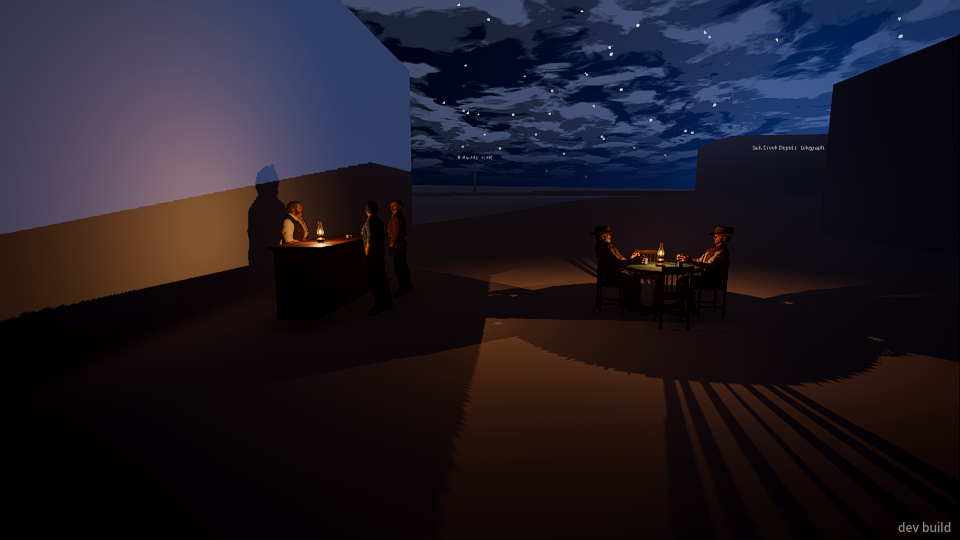
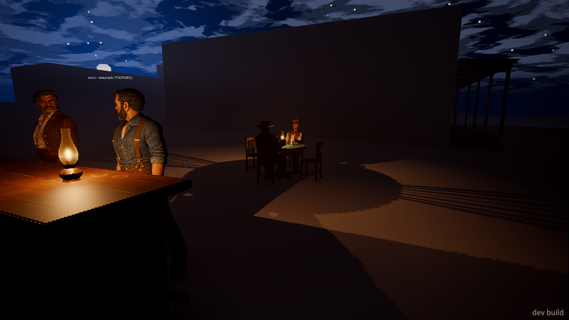

# The valley's townsfolk (#756, No Law step 1)

The code: `src/people/valley_folk.gd` (`ValleyFolk`), `src/people/sit_chore.gd` (`SitChore`); data
`config/valley_folk.json`; tests `tests/test_valley_folk.gd`; LAYOUT "src/people".

Sean hadn't answered #755 (the saloon onto its lot now, A, or in #695's week, B), so this is B: the
saloon stays a grey block and tonight's set is in its yard (`saloon_annex`, Sean's #700): a kit bar
with the barkeep behind it and two men drinking, the card table with Earl and the drifter sat at
it and the north and south chairs free, two lit oil lamps, tin cups. When the saloon goes onto its
lot the set moves inside (the data's `set` and `post`s) and the people with it.

## See it

```sh
godot -- --world=valley        # 7 (the hour key) three times: 21.30, everyone at his post
                               # 7 twice (17.36), then T to run the clock: they walk in from 19:00
python3 tools/bridge.py start --game-args=--world=valley
python3 tools/bridge.py "time 21" "wait 3" "camera 29.4 2.1 -7.2 28.4 0.9 -15.4 60" "screenshot /tmp/yard.png"
```

The yard is on Main Street's north side, ~30 m east of the crossroads, between the saloon's block
and the saloon lane.

| | |
|---|---|
|  |  |

## The frame at the saloon's yard

`tools/valley/valley_bench.gd --spots=crossroads,saloon_yard` drawn under lavapipe (real look, 60
frames), `--no-folk` (the before) and with them; at the yard the clock set to 21 (all five in).
Render CPU scaled to Sean's (x0.65); each drawn frame here runs 2 physics ticks (the catch-up cap),
so the people's ms a frame is two ticks' worth:

| Spot | render CPU at Sean's | draws | primitives | people (ms a frame, here) |
|---|---|---|---|---|
| `crossroads` (noon), before | 0.82 | 538 | 430k | 0.18 |
| `crossroads` (noon), the folk built, out | 0.73 | 538 | 430k | 0.12 |
| `saloon_yard` (21:00), before | 0.59 | 230 | 468k | 0.10 |
| `saloon_yard` (21:00), five men in | 1.01 | 823 | 4,889k | 5.84 |

Inside the budget (4.0 ms render CPU, 4.0 ms people at Sean's): +0.42 ms of render CPU, and the
people on the main thread ~4.3 ms a frame here (5.84 less `people_prep_sum`, the men's own work on
the worker pool, which the bench's sum counts again) = ~2.1 ms a tick = ~1.4 ms at Sean's. The
primitives are the five Studio men (GPU, not this budget). Load: the five men are built while the
valley loads, ~4.3 s the first time a process builds their models (then ~12 ms a man), plus ~0.25 s
for the folk's places and ~0.09 s for the set.

A sitting man can now tick slowly far from you (`SitChore.lets_slow`; a busy chore kept every man
at it on every tick, PeopleTick's bands).
